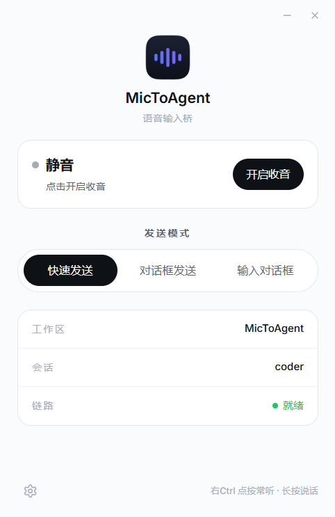
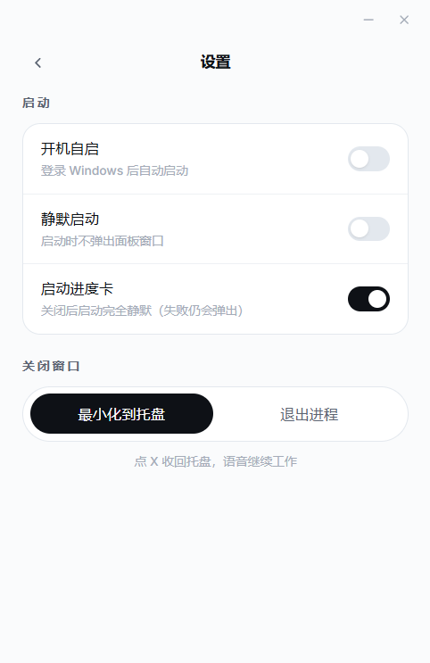

# MicToAgent

[中文](README.md) | [English](README.en.md)

Turn microphone speech into text and type it into the current agent session. Voice in only — read the reply in the target UI. Recognition runs entirely on your machine; audio is never sent to a third-party cloud.

The first adapter talks to **local Kimi Code Web** (hold or tap Right Ctrl).

> Unofficial. Not affiliated with Moonshot AI. "Kimi" is a trademark of Moonshot AI. This tool does not collect accounts or forward audio.

<p align="center">
  
  
</p>

## What it does / does not

- **Does**: On Windows, speak into the mic; recognized text is typed into the current agent session (same as typing). Currently wired to local `kimi web`.
- **Does not**: It is not [kimi.com](https://kimi.com) cloud chat. No TTS. No macOS / Linux / Firefox.

## Requirements

- Windows 10+, Python **3.10+**, Chrome or Edge, a microphone
- [Kimi Code CLI](https://www.kimi.com/code) installed
- Local `kimi web` running with the recommended command below
- CPU only; no GPU. Models must be downloaded (see below)

## Talking to Kimi Web (read this)

**Recommended default** (this machine, just for you):

```text
kimi web --dangerous-bypass-auth
```

The adapter sends **no Bearer token**. Stock `kimi web` with auth on will 401. Treat auth bypass as the matching way to start Web, not as optional.

That flag turns off Web login: anyone who can reach that port can control sessions, the filesystem, and the shell. Use it only on a trusted local machine.

The official default port is **58627**; if it is taken, it becomes 58628, 58629, …. Set `kimi_web_base` in `voice-bridge/config.json` (or `KIMI_WEB_BASE` in the repo-root `.env`) to match the address bar. This project **does not** scan ports.

MicToAgent's own adapter listens on `127.0.0.1:9100` with no auth. Do **not** change `listen_host` in `config.json` to `0.0.0.0` (that is this adapter, not a `kimi web` flag). Binding `0.0.0.0` would expose an unauthenticated port on every network interface.

## Install

```powershell
git clone https://github.com/YuyuX0101/MicToAgent.git
cd MicToAgent
py -3 -m venv .venv
.\.venv\Scripts\python.exe -m pip install -r requirements.txt
copy voice-bridge\config.example.json voice-bridge\config.json
copy .env.example .env
py -3 scripts\download_models.py
```

Every `.env` key is optional; a clone works without editing it. The template describes the default layout and when you would change a key. You can also download models by hand from the links in [`models/README.en.md`](models/README.en.md). Keep directory names exactly as documented and put them under `models/`.

Desktop shortcut (no console window):

```powershell
powershell -NoProfile -ExecutionPolicy Bypass -File scripts\create-desktop-shortcut.ps1
```

Or run `voice-assistant.ps1` (it forwards to `voice-launcher.pyw`).

## Config

`voice-bridge/config.json` is local (gitignored). Copy it from `config.example.json` the first time.

| Key | Meaning |
| --- | --- |
| `kimi_web_base` | Host and port from the browser address bar (the one you will most often change) |
| `listen_host` / `listen_port` | This adapter: keep `127.0.0.1:9100`; do not set `0.0.0.0` |
| `core.stt_engine` | `dual` (default: SenseVoice draft + qwen3 refine) or `qwen3_asr` |

Other keys: `config.example.json`. Optional: a repo-root `.env` to override paths or the port. After a GitHub clone you **usually do not** set `MICTOAGENT_ROOT`:

| Variable | Purpose | If unset |
| --- | --- | --- |
| `MICTOAGENT_ROOT` | Project root (`.venv` / `logs`) | This repo directory |
| `MICTOAGENT_MODELS` | ASR model directory | `<project root>/models` |
| `KIMI_WEB_BASE` | Overrides `kimi_web_base` in `config.json` | `config.json` |
| `KIMI_CLI` | kimi executable for long-transcript cleanup (optional; missing → submit as recognized) | `%USERPROFILE%\.kimi-code\bin\kimi.exe` |

## Use

1. Run `kimi web --dangerous-bypass-auth`, open it in Chrome or Edge, and **select a session** (or stay on the new-session draft page).
2. Double-click the desktop **MicToAgent** shortcut. When the startup card finishes, the control panel and tray icon appear by default. **Silent start** in Settings keeps only the tray next time.
3. On the panel, pick a send mode: **Quick send** (straight into the session, cannot attach images), **Dialog send** (paste and Enter, can attach a copied image), or **Into the composer** (paste only, no Enter). The last two require Kimi Web in the foreground with the composer focused; the app will toast instead of switching windows for you.
4. **Tap Right Ctrl** = always-on listen toggle. **Hold Right Ctrl** = push-to-talk; release to submit.
5. Close the panel to hide it in the tray (default). Left-click the tray icon (or the shortcut again) to bring the panel to the front. Stop: tray icon → right-click **Exit**, or set Close window to quit in Settings. Logs are in `logs/` (overwritten each start).

## Hotwords

Put misheard words in `voice-bridge/hotwords.txt` (one word per line, or `wrong=>right`). The list hot-reloads; the next utterance uses it.

## Troubleshooting

| Symptom | Check |
| --- | --- |
| Startup stuck on loading models | All three model files/dirs under `models/`, names exact; `logs/voice-assistant.err.log` |
| Tray icon never appears | Same as above; also whether `.venv` was installed from `requirements.txt` |
| Speech does not show in the page | Address-bar port equals `kimi_web_base`; a session is selected; Kimi Web is running |
| Toast “switch to Kimi Web” / “click the input box” | Dialog send / Into the composer: focus Kimi Web and the composer yourself; the app will not steal focus |
| Quick send cannot attach an image | That mode skips the composer; use Dialog send or Into the composer |
| "Not running" toast / 401 | Forgot `--dangerous-bypass-auth`; port matches `kimi_web_base` |
| Localhost fails with Clash / system proxy | The adapter only talks to `127.0.0.1` and ignores proxies; if it still fails, check the port |

**Do not** paste full `logs/` into an issue (they contain recognized text). Use an [issue template](https://github.com/YuyuX0101/MicToAgent/issues/new/choose).

## Architecture

```
mic → mic-gate (Right Ctrl gate, writes gate.state)
    → voice-core (ten-vad segments → SenseVoice draft / qwen3-asr refine → hotword fix)
    → adapter (OpenAI-compatible 127.0.0.1:9100, send-mode routing into Kimi Web)
voice-launcher starts all of the above plus the control panel.
```

Runtime code lives in `voice-bridge/`. Adapter details: [`voice-bridge/README.md`](voice-bridge/README.md) (Chinese). Contributing: [`CONTRIBUTING.md`](CONTRIBUTING.md).

## License

Code is [Apache-2.0](LICENSE). Third-party and model licenses: [NOTICE](NOTICE) and [`models/README.en.md`](models/README.en.md). **ten-vad is Apache 2.0 with extra restrictions** — read the upstream LICENSE before commercial use.

Security: [`SECURITY.md`](SECURITY.md).
