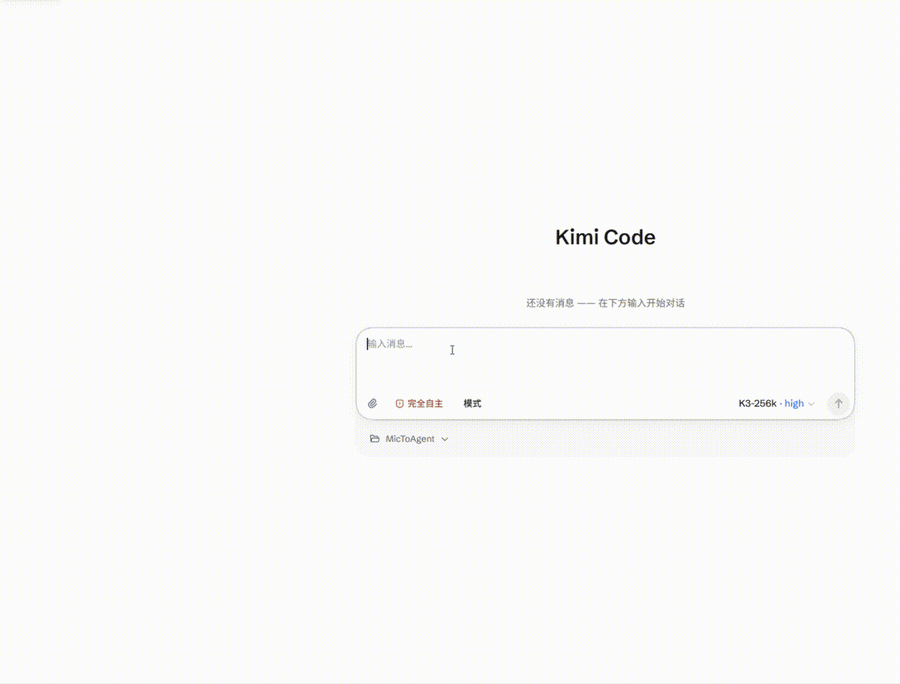

# MicToAgent

[中文](README.md) | [English](README.en.md)

Turn microphone speech into text and type it into the current agent session. Voice in only — read the reply in the target UI. Recognition runs entirely on your machine; audio is never sent to a third-party cloud.

Currently wired to **local Kimi Code Web**: **tap Right Ctrl** to toggle always-listening, **hold Right Ctrl** to push-to-talk.

> Unofficial. Not affiliated with Moonshot AI. "Kimi" is a trademark of Moonshot AI. This tool does not collect accounts or forward audio.

<p align="center">
  
</p>

<p align="center">
  
  
</p>

## Highlights

- **Text the moment you stop talking**: dual-engine relay — each speech segment gets an instant draft from SenseVoice while qwen3-asr refines it in the background; submission only waits for the draft, so there's zero lag. Pause mid-sentence to think and your words are stitched into one message, not split into two.
- **Three send modes, one click in the panel**: **Fast send** = straight into the current session, zero interruption (no images); **Dialog send** = paste and Enter, images allowed; **Compose box** = paste only, edit freely before sending. Hover any button for its description.
- **Follows your session seamlessly**: whichever session you select in Kimi Web is where your voice goes — switch sessions on the page and just keep talking, nothing to reconfigure. The panel shows the live workspace and session name, synced within a second when you rename a session.
- **One key, two styles**: **tap Right Ctrl** to toggle always-listening for hands-free multi-turn talk; **hold Right Ctrl** for push-to-talk, sent on release.
- **Hotwords that learn**: put misheard words in `voice-bridge/hotwords.txt` (one per line) and the very next sentence is corrected — no restart. Teach it your jargon and project terms.
- **Voice never leaves your machine**: recognition runs entirely locally (CPU-only, no GPU needed); audio is never sent to any third-party cloud.

## System requirements

Recognition runs locally — check before installing:

| Item | Requirement |
| --- | --- |
| OS | Windows 10 / 11 (64-bit); the panel needs the WebView2 runtime (built into Win11, usually preinstalled on Win10) |
| CPU | CPU-only inference, **no GPU needed**; 4+ cores recommended (recognition uses 4 threads by default) |
| RAM | ≥ 4 GB free (the two recognition models stay resident, ~1.5 GB) |
| Disk | ~1.2 GB for models, ~2 GB total including Python dependencies |
| Other | Python **3.10+**, Chrome or Edge, a microphone, [Kimi Code CLI](https://www.kimi.com/code) installed |

## Quick start

**Step 1 · Start Kimi Web** (run in a terminal, keep it running)

```text
kimi web --dangerous-bypass-auth
```

> ⚠️ This disables the web login: anyone who can reach the port can control sessions, the file system and the shell. Use only on your own machine in a trusted environment. MicToAgent's adapter sends requests without a token — disabling auth is the intended companion setup, not an optional extra.

**Step 2 · Install** (PowerShell)

```powershell
git clone https://github.com/YuyuX0101/MicToAgent.git
cd MicToAgent
py -3 -m venv .venv
.\.venv\Scripts\python.exe -m pip install -r requirements.txt
copy voice-bridge\config.example.json voice-bridge\config.json
py -3 scripts\download_models.py
```

**Step 3 · Create the desktop shortcut and launch**

```powershell
powershell -NoProfile -ExecutionPolicy Bypass -File scripts\create-desktop-shortcut.ps1
```

Double-click "MicToAgent" on the desktop. When the launch card finishes and the tray icon appears, you are ready. **Click a session** in Kimi Web, hold **Right Ctrl** and say something.

Models can also be downloaded manually via [`models/README.en.md`](models/README.en.md): if GitHub Releases are unreachable from your network, download them yourself and keep the directory names exactly as documented under `models/`.

## Daily use

- **Send modes** (switch anytime in the panel): **Fast send** = straight into the session, no images; **Dialog send** = paste and Enter, images allowed; **Compose box** = paste only, you review before sending. The latter two need Kimi Web in the foreground with the cursor in the input box — the app never switches windows for you and shows a notification instead.
- **Hotwords**: words the recognizer keeps getting wrong go into `voice-bridge/hotwords.txt` (one per line, or `wrong=>right`). Hot-reloaded, effective from the next sentence.
- **Stop**: tray right-click "Quit", or set "Close window" to quit in Settings. Closing the panel only returns it to the tray by default.
- Prefer no windows at startup: enable "Silent start" (no panel) and disable "Launch card" (fully silent) in Settings.
- Logs live in `logs/` (overwritten on every start) — read them before restarting.

## Troubleshooting

| Symptom | Check first |
| --- | --- |
| Stuck loading models | All three entries under `models/` present, names exact; `logs/voice-assistant.err.log` |
| Tray icon never appears | Same as above; also whether `.venv` was installed from `requirements.txt` |
| Speech never reaches the page | Browser port matches `kimi_web_base` (below); a session is selected; Kimi Web is running |
| "Switch to Kimi Web" / "Click the input box" notifications | You are on Dialog send / Compose box: switch and click the box yourself — the app will not do it for you |
| Fast send can't attach images | A limitation of that mode; use Dialog send or Compose box |
| "Not running" / 401 | Did you forget `--dangerous-bypass-auth`? Is the port aligned? |
| Local calls fail with Clash / system proxy on | The adapter only talks to `127.0.0.1` and bypasses the proxy; if it still fails, check the port |

**Port mismatch**: `kimi web` defaults to **58627**, falling back to 58628, 58629… when occupied. Set `kimi_web_base` in `voice-bridge/config.json` (or `KIMI_WEB_BASE` in the repo-root `.env`) to match your browser's address bar. This project never scans ports.

When filing an issue, **do not** paste full `logs/` (they contain your transcripts).

## Configuration (usually untouched)

`voice-bridge/config.json` is machine-local (gitignored); copy it from `config.example.json` once:

| Key | Meaning |
| --- | --- |
| `kimi_web_base` | Host and port matching the browser address bar (most common change) |
| `listen_host` / `listen_port` | This adapter — keep `127.0.0.1:9100`, **never** `0.0.0.0` (no auth) |
| `core.stt_engine` | `dual` (default: SenseVoice draft + qwen3 polish) or `qwen3_asr` |

Everything else is documented in `config.example.json`. The repo-root `.env` is fully optional (clones from GitHub usually do **not** need `MICTOAGENT_ROOT`):

| Variable | Purpose | Default |
| --- | --- | --- |
| `MICTOAGENT_ROOT` | Project root (`.venv` / `logs`) | This repository |
| `MICTOAGENT_MODELS` | Model directory | `<root>/models` |
| `KIMI_WEB_BASE` | Overrides `kimi_web_base` from `config.json` | `config.json` value |
| `KIMI_CLI` | kimi executable for long-text polishing (optional; without it long text is submitted verbatim) | `%USERPROFILE%\.kimi-code\bin\kimi.exe` |

## Architecture

```
mic → mic-gate (Right Ctrl gating, writes gate.state)
    → voice-core (ten-vad segmentation → SenseVoice draft / qwen3-asr polish relay → hotword fixes)
    → adapter (OpenAI-compatible API on 127.0.0.1:9100, forwards per send mode to the current Kimi session)
voice-launcher starts all of the above plus the control panel.
```

All runtime code lives in `voice-bridge/`. Adapter details: [`voice-bridge/README.md`](voice-bridge/README.md). Hacking: [`CONTRIBUTING.md`](CONTRIBUTING.md).

## Feedback

- **Bugs, ideas, usage questions**: open an [Issue](https://github.com/YuyuX0101/MicToAgent/issues/new/choose) — welcome.
- **Security vulnerabilities**: please do **not** open a public issue; use the private channel in [`SECURITY.md`](SECURITY.md).

## License

Code: [Apache-2.0](LICENSE). Third-party and model licenses: [NOTICE](NOTICE) and [`models/README.en.md`](models/README.en.md). **ten-vad uses a modified Apache 2.0 with extra commercial restrictions** — check the upstream LICENSE before commercial use.
